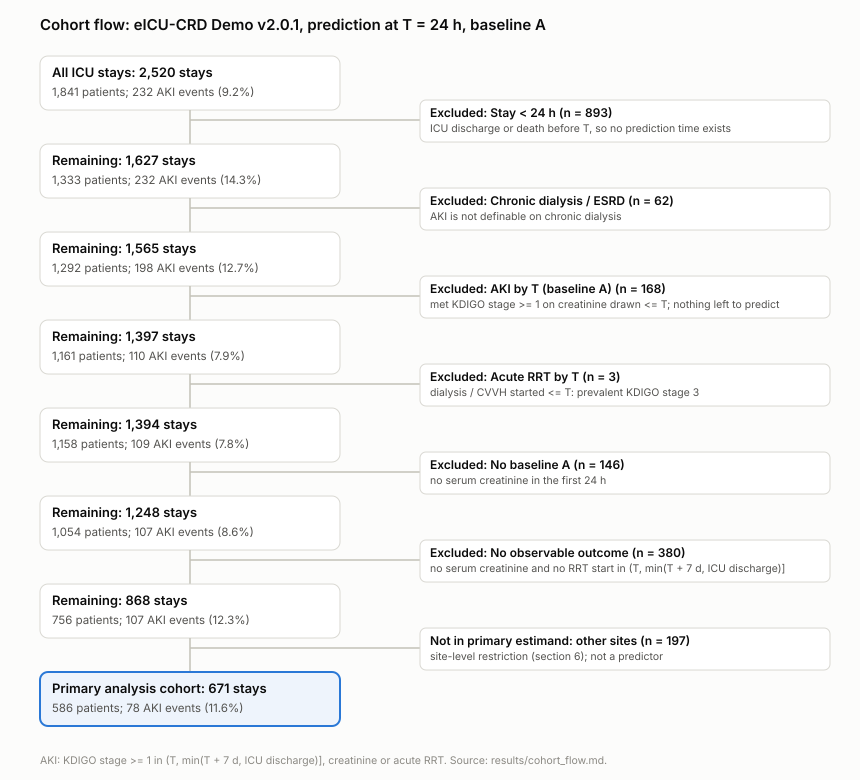
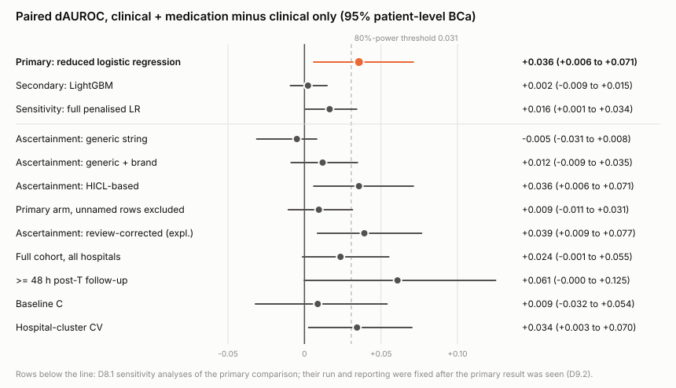
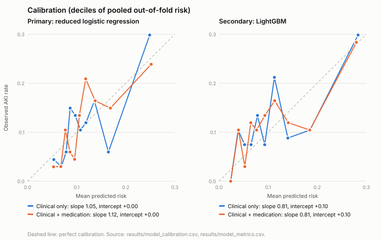

# PolySafe

**Does knowing which drugs an ICU patient is on improve prediction of acute kidney
injury?** A pre-registered, leakage-controlled answer on the eICU Collaborative Research
Database (Demo v2.0.1, 186 US hospitals), with drug exposure classified by a pharmacist.



## The answer

In 671 ICU stays at 141 hospitals that record medication orders, adding five
HICL-ascertained medication exposures (vancomycin, piperacillin-tazobactam, furosemide,
NSAIDs, iodinated contrast) to the pre-specified logistic regression raised the AUROC for
AKI after hour 24 from 0.641 to 0.677: **paired difference +0.036 (95% patient-level BCa
0.006 to 0.071)**. The gain was **not reproduced by LightGBM** (+0.002, -0.009 to 0.015),
and it attenuated under alternative exposure-ascertainment and baseline-creatinine
analyses, so it is a model-specific finding whose robustness is limited.

| Model (same 671 stays, repeated patient-grouped CV) | AUROC clinical | AUROC + medication | Paired dAUROC (95% BCa) | Calibration slope (clinical / + medication) |
|---|---:|---:|---|---|
| **Reduced L2 logistic regression (primary)** | 0.641 | 0.677 | **+0.036 (0.006 to 0.071)** | 1.05 / 1.12 |
| LightGBM (secondary) | 0.657 | 0.659 | +0.002 (-0.009 to 0.015) | 0.81 / 0.81 |
| Full penalised logistic regression (sensitivity) | 0.624 | 0.640 | +0.016 (0.001 to 0.034) | 0.95 / 1.02 |

The pre-registered power simulation put the 80%-power threshold at a dAUROC of 0.031.
AUPRC did not improve (0.216 vs 0.213 for the primary model). Source:
[`results/models.md`](results/models.md).





## What moves the answer

The sensitivity analyses ([`results/sensitivity.md`](results/sensitivity.md)) were named
before any model was fitted; how they were run was fixed after the primary result was
seen, and the pre-registration says so (D9.2).

- **How drugs are counted matters most.** Matching drug-name strings gives no gain
  (-0.005); adding brand names gives +0.012; HICL-code ascertainment gives +0.036. 40.6% of
  medication rows have no drug name, and many exposures exist only in those rows: 42 of 93
  piperacillin-tazobactam and 37 of 106 vancomycin exposures. Excluding unnamed rows drops
  the gain to +0.009.
- **Is that a documentation artifact?** An exploratory check specified after the results
  (D10.1, [`results/exploratory_d10.md`](results/exploratory_d10.md)): a marker for
  "this stay has unnamed medication rows" adds nothing on its own (-0.001), and the drug
  gain survives adjustment for it (+0.035, 0.006 to 0.070). The marker is present in 89% of
  stays, so this check is weak; it does not support the artifact explanation, and it does
  not rule it out.
- **Other cohorts and definitions.** Hospital-cluster CV (no hospital or patient in two
  folds): +0.034 (0.003 to 0.070).
  All 868 stays at all hospitals: +0.024 (-0.001 to 0.055).
  Pre-ICU creatinine as baseline (baseline C, 497 stays): +0.009 (-0.032 to 0.054), which
  does not reproduce the primary magnitude.

## What this does not show

- That medication exposure adds information beyond what a flexible clinical model already
  captures: LightGBM, with the higher clinical-only AUROC, gained nothing.
- That the model is clinically useful, or that it should inform prescribing. No individual
  patient's risk is presented anywhere (78 events, EPV 4.6).
- That the result transfers to hospitals without medication capture, or to other ICUs.
- Anything causal about these drugs.

## Secondary: drug-AKI associations (associational only)

Propensity-adjusted for baseline severity, 651 stays, ondansetron as negative control
([`results/secondary.md`](results/secondary.md), section 10, D11.1):

| Agent | Exposed (AKI) | Crude OR (95% CI) | Adjusted OR (95% CI) |
|---|---:|---|---|
| Vancomycin | 106 (14) | 1.21 (0.54-2.17) | 1.06 (0.49-2.01) |
| Piperacillin-tazobactam | 93 (17) | 1.93 (0.95-3.38) | 1.77 (0.89-3.22) |
| Furosemide | 141 (28) | 2.44 (1.45-3.90) | 1.97 (1.12-3.37) |
| Ondansetron (negative control) | 314 (37) | 1.05 (0.63-1.71) | 1.24 (0.75-2.12) |

Furosemide's association survives adjustment for the measured severity markers; it is
given for fluid overload and heart failure, which also predict AKI, so confounding by
indication is the expected explanation.

## Design

| | |
|---|---|
| Data | eICU-CRD Demo v2.0.1 (PhysioNet, ODbL): 2,520 ICU stays, 1,841 patients |
| Prediction time | T = 24 h after ICU admission; every feature uses only data with offset <= T |
| Outcome | KDIGO stage >= 1 in (T, min(T + 7 d, ICU discharge)]: creatinine +0.3 mg/dL in 48 h or 1.5x baseline, or acute RRT started after T |
| Baseline creatinine | A (primary): first serum creatinine in 0-24 h. C (sensitivity): last pre-ICU value |
| Exclusions | Stay < 24 h; chronic dialysis/ESRD; AKI or RRT by T; no baseline; no observable outcome |
| Estimand | Among ICU stays at hospitals that record medication orders (site-level restriction; record availability is never a predictor, and a missing record is never coded unexposed) |
| Exposure | An active medication order in [0, T], not cancelled (D6.4). eICU records orders, not administrations |
| Drug classification | HICL codes, adjudicated key by key by a PharmD (171 review-packet keys) |
| Validation | Repeated stratified patient-grouped CV, 5 folds x 10 repeats; inner patient-grouped tuning; patient-level BCa, 10,000 resamples |
| Pre-registration | [`PREREGISTRATION.md`](PREREGISTRATION.md), committed before any model was fitted; changes only by appended Deviations (D1-D11), enforced by a test over every commit |

## Limitations

- 78 events (EPV 4.6): internal validation only, and an exploratory prediction study, not
  a validated clinical tool.
- The BCa intervals resample patients over fixed out-of-fold predictions; they do not
  include model-refitting variability (the coverage simulation measured 93-94% coverage
  for the dAUROC interval in the matched cells).
- The outcome is observed only while the patient is in the ICU, so follow-up is
  incomplete for early discharges.
- The demo is a small sample of eICU-CRD; nothing here has been externally validated.

## Reproduce

Python 3.12. Download the eICU-CRD Demo v2.0.1 tables into `data/` and check them against
`data/SHA256SUMS.txt`, then:

```
pip install -r requirements.txt -r requirements-dev.txt -e .
python -m polysafe.pipeline          # labels -> features -> exposure -> models -> ... -> lab
git diff --stat results/             # empty on a faithful rerun
pytest                               # 235+ tests, including leakage and protocol guards
```

The Research Lab page, which shows every number above with its source, runs without
the data:

```
docker build -t polysafe-lab . && docker run -p 8000:8000 polysafe-lab
```

## Authorship

Designed, analysed and drug-classified by Dr. Varad Vaidya (PharmD). Code was written with
AI assistance (Claude); every analytic decision is recorded in the pre-registration with
its date and whether results had been seen.
